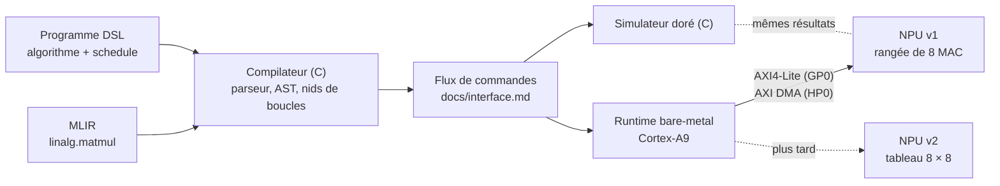

# zynq-npu

Un NPU int8 en SystemVerilog, et le compilateur qui le programme, sur ZedBoard (Zynq-7020).

[](https://github.com/Quentin0l/zynq-npu/actions/workflows/ci.yml)

**Aujourd'hui, le NPU v1 exécute sur la carte le réseau MNIST entier** (784 → 512 → 256 → 128 → 64 → 10, quantifié par AIfES), et ses logits sont ceux d'AIfES au bit près. La suite du projet, jusqu'au 13 décembre 2026, construit la chaîne logicielle qui le programme : le compilateur, son simulateur doré, un modèle de coût et un autotuner.

La cible : un GEMM ou un réseau s'écrit dans un petit DSL qui sépare **l'algorithme**, ce que l'on calcule, du **schedule** : comment on le découpe en tuiles, et dans quel ordre. Une seconde entrée, en MLIR, part de `linalg.matmul`. Le compilateur, écrit en C, abaisse le programme en nids de boucles, puis émet un **flux de commandes**. Le runtime du Cortex-A9 décode ce flux et pilote le NPU par ses registres et par DMA. Le même format pourra plus tard être décodé par le NPU lui-même, sans que le compilateur change. Un simulateur en C sert de référence dorée : le RTL doit lui donner raison au bit près.



## Ce qui tourne

**Sur la carte.** L'IP `npu_axi` 2.0 (registre VERSION `0x4E50_5502`) tourne dans la logique programmable à 33,33 MHz, avec une marge de timing positive (WNS +0,97 ns). Le Cortex-A9 la pilote par registres AXI4-Lite. Un AXI DMA sur le port HP0 lui envoie les poids de la couche 1 en flux, à 264 Mo/s mesurés, soit presque le plafond d'un flux de 64 bits à cette fréquence. Les poids des couches 2 à 5 restent en BRAM. Le réseau MNIST entier s'exécute ainsi, couche après couche, et rend les logits d'AIfES au bit près. Le block design et le bitstream se reconstruisent depuis le dépôt (`hw/build_hw.tcl`), et les applications bare-metal aussi (`sw/build_sw.py`).

**En simulation.** Chaque brique du moteur a son banc cocotb et ses mutants. Le réseau entier y est vérifié au bit près contre AIfES compilé en C (`tb/test_reseau.py`), en 73 022 cycles par image. Côté v2, le PE et le tableau 8 × 8 passent leur premier test, une tuile 8 × 8 × 8.

**Ailleurs.** Le même GEMM int8 → int32 tourne en OpenCL (`opencl/`), sur le GPU d'un Mac ou sur CPU par [PoCL](https://portablecl.org/) : un kernel naïf et un kernel tuilé en mémoire locale, vérifiés au bit près contre la référence de `ref/`. Côté compilateur, le lexeur est fini (`compiler/lexer/`).

## Le NPU

**v1, le moteur matrice-vecteur** (`rtl/moteur/`). C'est une rangée de P MAC int8 → int32, output-stationary, avec P = 8 sur la carte. Il comprend :
- un tampon de poids en BRAM, dont chaque mot donne un poids à chaque MAC, et une file pour les poids qui arrivent en flux ;
- une unité de requantification int32 → int8, ReLU comprise, qui tronque comme AIfES ;
- un séquenceur, une machine d'états qui exécute seule une couche entière, passe après passe.

Les 574 080 poids du réseau dépassent les BRAM du XC7Z020 (573 440 octets) : ceux de la couche 1, 70 % du total, arrivent de la DDR pendant le calcul.

**v2, le tableau systolique 8 × 8** (`rtl/tableau/`). Il calcule un GEMM par tuiles de 8 × 8, avec 64 MAC et des données qui ne voyagent qu'entre PE voisins. Le PE et le tableau existent ; le décalage d'entrée et le contrôleur viendront après décembre. Il se branchera derrière le même format de commandes que la v1.

**Le contrat** (`docs/interface.md`, v0.9) décrit les registres, le flux, les tampons et le rangement en mémoire, avec le réseau MNIST comme exemple complet. Il passe en v1.0 avec le format des commandes (semaine 1).

## Les trois dernières semaines

Les huit semaines prévues du 5 octobre au 29 novembre ont livré le NPU sur la carte, mais pas encore la chaîne logicielle. Le plan est resserré en trois semaines, jusqu'au 13 décembre, et centré sur le compilateur. Chacune finit sur un livrable vérifiable. Le récit est dans le [journal](JOURNAL.md).

| Semaine | Objectif | Livrable | État |
|---|---|---|---|
| **1** · 23 au 29 nov. | Le flux de commandes et le simulateur doré | Un flux écrit à la main, décodé par le runtime, fait tourner MNIST sur la carte avec les mêmes octets que le simulateur | 🚧 |
| **2** · 30 nov. au 6 déc. | Du DSL à la carte | Le compilateur émet le flux ; un GEMM et MNIST tournent sur la carte depuis le DSL ; duel NPU / NEON | ⏳ |
| **3** · 7 au 13 déc. | Mesurer, chercher, MLIR, montrer | Un modèle de coût dont l'erreur est chiffrée, un autotuner, un front-end MLIR, un dépôt fini | ⏳ |

### Semaine 1 · Le flux de commandes et le simulateur doré

- [ ] Mesurer le réseau sur la carte : cycles par couche (registre DUREE), latence par image, précision sur les 10 000 images de test
- [ ] Définir le format des commandes dans le contrat, qui passe en v1.0 : opcodes, champs, encodage en mots de 64 bits
- [ ] Écrire le simulateur doré en C (`sim/`) : il exécute un flux de commandes avec l'arithmétique d'AIfES, au bit près
- [ ] Écrire le runtime qui décode le flux sur le Cortex-A9 : registres, DMA de la couche 1, attente
- [ ] Faire tourner MNIST par un flux écrit à la main, et le comparer au simulateur octet par octet
- [ ] Figer la grammaire du DSL (`docs/dsl.md`, v1.0), puis écrire le parseur et l'AST

### Semaine 2 · Du DSL à la carte

- [ ] Abaisser l'AST en nids de boucles selon le schedule, vérifier sa légalité (k en boucle intérieure, tuile N = P), puis émettre le flux de commandes
- [ ] Un GEMM et le réseau MNIST écrits dans le DSL, compilés, exécutés sur la carte, vérifiés contre le simulateur
- [ ] Harnais de justesse sur la carte : des GEMM de tailles et de schedules tirés au hasard, comparés au simulateur
- [ ] Allocation des tampons d'activations sur puce par le compilateur, d'après la durée de vie de chaque tenseur
- [ ] Référence NEON sur le Cortex-A9 : GEMM int8 en intrinsics, mesuré en cycles
- [ ] Tableau de mesures : NPU, NEON et OpenCL, bande passante réelle du DMA, relevé d'implémentation (LUT, DSP, BRAM, timing)

### Semaine 3 · Mesurer, chercher, MLIR, montrer

- [ ] Modèle de coût analytique (calcul, DMA, commandes), avec son erreur chiffrée contre la carte ; roofline avec les points mesurés
- [ ] Autotuner : recherche exhaustive des schedules légaux, guidée par la mesure ou par le modèle ; comparaison avec OpenTuner et ytopt
- [ ] Front-end MLIR : `linalg.matmul` abaissé jusqu'au même flux de commandes que le DSL
- [ ] Montrer : ce README en version finale, une démonstration filmée, un dépôt reproductible, un tableau de correspondance avec l'état de l'art (TPU v1, Eyeriss, VTA, Gemmini)

### Après décembre

- Un décodeur de commandes en RTL, qui lit le flux directement par DMA, pour le même format
- Le NPU v2 : décalage d'entrée, contrôleur, co-simulation, puis sur la carte, avec un duel v1 / v2

## Le dépôt

| Dossier | Contenu |
|---|---|
| `rtl/moteur/` | NPU v1 : MAC, rangée, tampon et file de poids, moteur de passe, requantification, séquenceur, couche |
| `rtl/axi/` | L'enveloppe de l'IP : registres AXI4-Lite, aiguillage du flux AXI4-Stream |
| `rtl/tableau/` | NPU v2 : PE, tableau systolique, décalages d'entrée |
| `tb/` | Bancs cocotb + Verilator, modèles Python au bit près, mutants, le réseau MNIST et ses images de test |
| `hw/` | Empaquetage de l'IP, block design, reconstruction du bitstream, simulation de l'IP |
| `sw/` | Applications bare-metal du Cortex-A9, et leur reconstruction par Vitis |
| `ref/` | GEMM de référence en C : naïf, et parcouru selon un schedule |
| `opencl/` | Le GEMM en OpenCL : hôte C++17 et CMake, kernels naïf et tuilé |
| `compiler/` | Le compilateur du DSL, en C (aujourd'hui : le lexeur) |
| `docs/` | Le contrat d'interface, la grammaire du DSL, le journal des bugs, les notes de lecture |

À venir : `sim/`, le simulateur doré (semaine 1) ; `bench/`, les mesures et l'autotuner (semaines 2 et 3) ; `mlir/`, le front-end MLIR (semaine 3).

## Lancer les tests

Il faut Verilator 5.036 ou plus récent, Python 3 et un compilateur C.

```sh
python3 -m venv .venv && .venv/bin/pip install -r requirements.txt
make test
```

`make test` vérifie ce qui est fini : le lexeur et le NPU v1, réseau MNIST compris. Le reste se lance à part : `tb/check.sh v2` pour le tableau, `ref/check.sh` pour les GEMM en C, `opencl/check.sh` pour OpenCL (avec CMake et une implémentation d'OpenCL), ou une seule suite, comme `tb/check.sh reseau`. La CI affiche aussi les travaux en cours, sans qu'ils la bloquent.

**Des mutants pour juger les tests.** Chaque banc tourne d'abord sur le RTL, puis sur des copies où un bug a été planté (`tb/mutants/`). Si un mutant survit, il manque un test.

**Sur la carte**, il faut Vivado et Vitis 2026.1. Le bitstream se reconstruit depuis `hw/build` avec `vivado -mode batch -source ../build_hw.tcl`, puis les applications avec `vitis -s sw/build_sw.py` depuis la racine du dépôt.

## La cible

ZedBoard, XC7Z020 : 53 200 LUT, 106 400 bascules, 220 DSP48E1, 140 BRAM de 36 Kb ; deux Cortex-A9 à 667 MHz ; quatre ports AXI HP de 64 bits vers 512 Mo de DDR3. La logique programmable tourne à 33,33 MHz. Le moteur v1 occupe un DSP par MAC : P = 8 sur la carte et dans les bancs, et jusqu'à 220 sur la puce. Le tableau v2 en occupe 64.

## Conventions

SystemVerilog aux conventions ISMIN (Mines Saint-Étienne) : suffixes `_i`, `_o`, `_s`, `_g`, reset asynchrone actif bas `resetb_i`, blocs nommés. Code et documentation en français.

## Provenance

Projet personnel, mené avec un parcours d'apprentissage guidé par une IA (Claude, d'Anthropic) : leçons, squelettes d'exercices et outils de vérification. Les fichiers fournis en tout ou en partie par ce parcours le disent dans leur en-tête.
