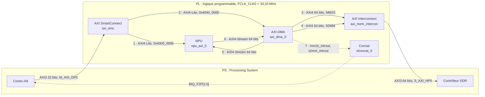

# Contrat d'interface du NPU

> **Statut : v0.9, 19 novembre 2026.** Décrit l'IP `npu_axi` 2.0 telle qu'elle tourne sur la ZedBoard. Se fige en v1.0 quand le réseau MNIST complet tournera sur la carte. Ensuite, tout changement donne une nouvelle version et une ligne dans l'historique, en bas.
>
> Provenance : rédigé par le parcours d'apprentissage (agent), à la demande de l'auteur du dépôt, d'après le RTL (`rtl/axi/`, `rtl/moteur/`), le block design (`hw/bd/system.tcl`) et les mesures sur la carte.

Ce document est le contrat entre les implémentations qui ne doivent jamais diverger : le RTL (`rtl/`), le runtime du Cortex-A9 (`sw/`), et plus tard le compilateur (`compiler/`) et le simulateur doré (`sim/`). Chacune se construit à partir de lui seul.

Il décrit le NPU v1, le moteur de `rtl/moteur/`, derrière l'enveloppe `rtl/axi/npu_axi.v`. Le tableau v2 (`rtl/tableau/`) devra pouvoir se brancher derrière les mêmes interfaces.

**Le test d'un bon contrat.** Deux personnes qui ne se parlent pas l'implémentent chacune de leur côté. Leurs octets sont identiques, au bit près.

## 1. Vue d'ensemble



Une flèche pleine va du **maître** vers l'**esclave**, jamais dans le sens des données. Une flèche pointillée est un fil d'interruption, sans maître ni esclave : elle suit le signal.

Toute la PL tourne sur **FCLK_CLK0 = 33,333 MHz**, fourni par le PS (PLL des entrées-sorties à 1000 MHz, divisée par 30 ; mesuré sur la carte : 33 333 336 Hz). Le reset de la PL vient du Processor System Reset `rst_ps7_0_100M` (sortie `peripheral_aresetn`, actif bas), lui-même piloté par `FCLK_RESET0_N`. Le nom en « 100M » est un reste de la première version, à 100 MHz.

Le NPU a trois interfaces : un esclave AXI4-Lite (`s_axi`, ses registres), un esclave AXI4-Stream (`s_axis`, le flux entrant) et un maître AXI4-Stream (`m_axis`, utilisé seulement en mode BOUCLE). Il n'est jamais maître de la mémoire : c'est le DMA qui l'est pour lui. Le NPU ne lève pas d'interruption : l'ARM scrute STATUS.

| Esclave | Vu par | Base | Taille |
|---|---|---|---|
| registres du NPU | PS (GP0) | `0x4000_0000` | 4 Ko |
| registres du DMA | PS (GP0) | `0x4040_0000` | 64 Ko |
| DDR, par HP0 | DMA (MM2S et S2MM) | `0x0000_0000` | 512 Mo |

## 2. Registres de contrôle (AXI4-Lite, port M_AXI_GP0)

32 bits de données, 12 bits d'adresse. Une adresse désigne un octet, un registre en fait 4 : le numéro du registre est l'adresse sans ses 2 bits de poids faible. Toutes les réponses sont OKAY. Une adresse inconnue se lit 0, et une écriture y est sans effet. `WSTRB` n'est pris en compte que pour SCRATCH : les autres registres s'écrivent en entier.

| Offset | Nom | Accès | Champs | Valeur au reset |
|---|---|---|---|---|
| 0x00 | VERSION | L | `0x4E50_5502` : « NPU » en ASCII, puis la version 02 | `0x4E50_5502` |
| 0x04 | SCRATCH | L/É | libre, octet par octet (WSTRB) | 0 |
| 0x08 | CYCLES | L | fronts de FCLK_CLK0 depuis le reset, sur 32 bits (repasse à 0) | 0 |
| 0x0C | CTRL | É | bit 0 : START | lu 0 |
| 0x10 | STATUS | L | bit 0 : BUSY ; bit 1 : DONE | 0 |
| 0x14 | DUREE | L | cycles de la dernière couche | 0 |
| 0x18 | FLUX | L/É | bits 1:0 : destination de S_AXIS (§3) | 0 (BOUCLE) |
| 0x1C | W_ADDR | L/É | bits 14:0 : adresse du prochain mot chargé en mode TAMPON | 0 |
| 0x20 | BIAS_ADDR | L/É | bits 9:0 : adresse du prochain biais | 0 |
| 0x24 | BIAS_DATA | É | fenêtre : un biais int32 | lu 0 |
| 0x28 | ACT_ADDR | L/É | bits 10:0 : adresse de la prochaine activation | 0 |
| 0x2C | ACT_DATA | L/É | fenêtre : un octet signé (lu étendu sur 32 bits avec son signe) | — |
| 0x30 | N | L/É | bits 9:0 : nombre d'entrées de la couche | 0 |
| 0x34 | M | L/É | bits 9:0 : nombre de sorties | 0 |
| 0x38 | W_BASE | L/É | bits 14:0 : première tuile dans le tampon de poids | 0 |
| 0x3C | IN_BASE | L/É | bits 10:0 : zone des entrées | 0 |
| 0x40 | OUT_BASE | L/É | bits 10:0 : zone des sorties | 0 |
| 0x44 | BIAS_BASE | L/É | bits 9:0 : premier biais de la couche | 0 |
| 0x48 | M0 | L/É | multiplicateur entier, dans [2^30, 2^31) ; `0x4000_0000` avec AIfES | 0 |
| 0x4C | SHIFT | L/É | bits 4:0 : décalage | 0 |
| 0x50 | ZP | L/É | bits 7:0 : point zéro de la sortie, signé (lu étendu) | 0 |
| 0x54 | OPTIONS | L/É | bit 0 : RELU ; bit 1 : W_STREAM (poids en flux) | 0 |

Les champs trop courts sont tronqués à l'écriture, et lus avec des zéros devant (ZP et ACT_DATA : étendus avec leur signe).

**Commande.**

- **R6.** Une écriture dans CTRL avec le bit 0 à 1 lance la couche décrite par N à OPTIONS, sauf si BUSY vaut 1 : elle est alors ignorée.
- **R7.** DONE passe à 1 à la fin de la couche, et revient à 0 au START suivant. BUSY vaut 1 du lancement à la fin de la couche.
- **R8.** DUREE est remise à 0 au START, puis compte les cycles où BUSY vaut 1 : T·(n + 2) + m + 1 sans bulle, avec T = ⌈m / 8⌉, plus un cycle par bulle en mode flux (§3).
- Le descripteur (N à OPTIONS) doit rester stable du START à DONE. Le NPU ne le vérifie pas : c'est au runtime d'y veiller.

**Fenêtres.**

- **R9.** Chaque écriture dans BIAS_DATA écrit un biais à l'adresse BIAS_ADDR, puis BIAS_ADDR + 1. Une écriture dans BIAS_ADDR fixe l'adresse.
- **R10.** Chaque écriture dans ACT_DATA écrit l'octet `wdata[7:0]` à l'adresse ACT_ADDR, sauf si BUSY vaut 1 (le séquenceur tient alors le tampon : l'écriture est perdue). Chaque lecture de ACT_DATA rend l'octet à ACT_ADDR. Chacune fait ensuite ACT_ADDR + 1. Une écriture dans ACT_ADDR fixe l'adresse.

**Réponses aux questions de la v0.**

- *Lancement et fin* : START dans CTRL, puis scrutation de STATUS.DONE. Pas d'interruption du NPU en v1.
- *Compteur de cycles* : DUREE pour la dernière couche, CYCLES pour une horloge libre.
- *Commande invalide* : rien n'est détecté. Un START pendant BUSY est ignoré, un champ trop large est tronqué. Un descripteur incohérent (n = 0, zones qui se chevauchent) donne des sorties fausses sans prévenir.
- *Bon bitstream* : le runtime lit VERSION et vérifie `0x4E50_5502` avant tout.

## 3. Le flux de données

### 3.1 Transport

Il n'y a pas de flux de commandes : le descripteur de chaque couche passe par les registres (§2). Le flux AXI4-Stream (MM2S du DMA → `s_axis`) ne porte que des **poids**. Le registre FLUX dit où ils vont.

| FLUX | Nom | Destination | Usage |
|---|---|---|---|
| 0 | BOUCLE | `m_axis`, tel quel (`s_axis_tready = m_axis_tready`) | tester le DMA ; valeur au reset |
| 1 | TAMPON | tampon de poids, à l'adresse W_ADDR, qui avance d'un mot par mot reçu (`s_axis_tready = 1`) | poids des couches stockées, une fois au démarrage |
| 2 | FILE | file de poids du moteur, 16 mots (`s_axis_tready` = file non pleine) | poids de la couche en flux, pendant qu'elle se calcule |
| 3 | — | réservé : rien ne passe (`s_axis_tready = 0`) | — |

TLAST et TKEEP ne servent qu'en BOUCLE : ailleurs, ils sont ignorés. Le DMA lève TLAST en fin de transfert, sans effet sur le NPU.

Qui transporte quoi :

| Donnée | Taille (réseau MNIST) | Quand | Par où |
|---|---|---|---|
| poids des couches 2 à 5 | 21 632 mots, 173 056 octets | une fois | DMA, FLUX = 1 |
| biais des 5 couches | 970 × int32 | une fois | BIAS_DATA |
| image | 784 octets | par image | ACT_DATA |
| poids de la couche 1 | 50 176 mots, 401 408 octets | par image, pendant la couche | DMA, FLUX = 2 |
| descripteur | 10 registres | par couche | N à OPTIONS |
| logits | 10 octets | par image | ACT_DATA, en lecture |

### 3.2 Format d'un mot de poids

Un mot fait 64 bits : P = 8 octets, un par MAC. Le mot j d'une tuile t porte la **colonne j** de la tuile : l'octet k (bits 8k+7 à 8k) est le poids qui relie l'entrée j à la sortie 8t + k.

- Une couche de m sorties a T = ⌈m / 8⌉ tuiles. Les mots se suivent tuile après tuile, et dans une tuile de j = 0 à n − 1. La tuile t commence au mot W_BASE + t·n.
- Dans la dernière tuile, les octets des sorties qui n'existent pas (8t + k ≥ m) sont ignorés : on y met 0.
- En DDR, un mot occupe 8 octets consécutifs, petit-boutiste : l'octet d'adresse la plus basse arrive sur `tdata[7:0]`, donc au MAC 0.
- En mode FILE, les mots arrivent dans le même ordre, tuile après tuile.

C'est l'ordre de `couche_en_mots` (`tb/modele_npu.py`), qui fait référence.

### 3.3 Séquence d'une couche, côté runtime

1. Attendre BUSY = 0.
2. Écrire N, M, W_BASE, IN_BASE, OUT_BASE, BIAS_BASE, M0, SHIFT, ZP, OPTIONS.
3. Couche en flux seulement : FLUX = 2, puis lancer le transfert MM2S des poids de la couche (cache vidé, §6).
4. CTRL = 1.
5. Attendre STATUS.DONE = 1 ; en flux, attendre aussi la fin du transfert MM2S.
6. Lire DUREE si besoin.

Les couches s'exécutent strictement l'une après l'autre. Seul recouvrement : en mode FILE, le DMA livre les poids pendant que la couche se calcule.

## 4. Les tampons locaux

| Tampon | Rôle | Largeur d'un mot | Profondeur | Ce que contient un mot | Double tampon ? |
|---|---|---|---|---|---|
| poids | les couches stockées (BRAM) | 64 bits | 32 768 mots | une colonne de tuile (§3.2) | non |
| file de poids | la couche en flux | 64 bits | 16 mots | idem | non |
| activations | entrées et sorties des couches (LUT-RAM) | 8 bits | 2 048 octets | une activation int8 | deux zones : A = `0x000`, B = `0x400` |
| biais | biais corrigés (LUT-RAM) | 32 bits | 1 024 | un biais int32 | non |

- **P = 8 MAC.** Un mot de poids fait donc 8 octets.
- **Les adresses comptent des mots** dans le tampon de poids (W_ADDR, W_BASE), des octets dans le tampon d'activations (ACT_ADDR, IN_BASE, OUT_BASE) et des biais dans le tampon de biais (BIAS_ADDR, BIAS_BASE).
- **Les sommes partielles ne quittent jamais les accumulateurs.** Une passe calcule 8 sorties complètes, sur toutes les entrées, puis les vide. Le compilateur ne peut donc émettre que des nids de boucles où la réduction sur les entrées est la plus interne.
- **Le NPU sort des int8 requantifiés, ReLU comprise.** C'est lui qui requantifie (`rtl/moteur/requant.sv`), sur 64 bits signés :
  - Q1. v = acc + b′, où b′ est le biais corrigé.
  - Q2. p = v × M0.
  - Q3. r = p >>> (31 + SHIFT), décalage arithmétique **sans arrondi**, comme AIfES.
  - Q4. y = r + ZP.
  - Q5. q = y écrêté dans [plancher, 127], avec plancher = ZP si RELU, et −128 sinon.
- **Le biais corrigé se calcule hors ligne** : b′ = b − z_entrée · Σ W, ce qui replie la correction du point zéro de l'entrée (`descripteurs_npu`, `tb/aifes_q7.py`).

## 5. Largeurs des bus et chemins de données

| Lien | Protocole | Largeur | Fréquence | Débit théorique |
|---|---|---|---|---|
| ARM → NPU, contrôle | AXI3 (M_AXI_GP0) → SmartConnect → AXI4-Lite | 32 bits | 33,33 MHz | une transaction par mot |
| DDR → NPU, données | S_AXI_HP0 (AXI3) → AXI Interconnect → AXI DMA (MM2S) → AXI4-Stream | 64 bits | 33,33 MHz | 266,7 Mo/s |
| NPU → DDR, résultats | AXI4-Stream → AXI DMA (S2MM) → S_AXI_HP0 | 64 bits | 33,33 MHz | 266,7 Mo/s (mode BOUCLE seulement) |

Mesures sur la carte : 401 408 octets en boucle (MM2S et S2MM en même temps) en 1 516 µs, soit 264 Mo/s (99 % du théorique) ; 793 Mo/s avec la v1 à 100 MHz. Le DMA est réglé en mode simple (sans scatter-gather), avec des rafales de 16 et un registre de longueur de 26 bits (67 108 863 octets au plus par transfert).

## 6. Rangement en mémoire (DDR)

- **Les poids sont rangés en DDR déjà dans l'ordre du §3.2.** Le réarrangement se fait hors ligne (script Python, à partir de la mémoire de paramètres d'AIfES), pas par le runtime ni par le matériel.
- **L'image est quantifiée comme dans AIfES** : q = (256·p − 32385) div 510, pour un pixel p de 0 à 255, ce qui donne un int8 entre −64 et 64 (`quantifier_entree`, `tb/aifes_q7.py`).
- **Alignement** : tout tampon lu ou écrit par le DMA est aligné sur 32 octets (une ligne de cache du Cortex-A9), et sa taille est un multiple de 32. Le DMA, sans DRE, exige au moins 8 octets.
- **Cache** : avant un transfert MM2S, le runtime vide le cache sur le tampon source (`Xil_DCacheFlushRange`). Après un transfert S2MM, il l'invalide sur le tampon de destination (`Xil_DCacheInvalidateRange`). Le port HP0 ne voit pas les caches.

## 7. Exemple complet : le réseau MNIST d'AIfES

Le réseau 784 → 512 → 256 → 128 → 64 → 10, avec le placement de `tb/test_reseau.py` : couche 1 en flux, couches 2 à 5 l'une après l'autre dans le tampon, biais à la suite, zones d'activations qui alternent.

| Couche | N | M | W_BASE | Mots | IN_BASE | OUT_BASE | BIAS_BASE | M0 | SHIFT | ZP | OPTIONS |
|---|---|---|---|---|---|---|---|---|---|---|---|
| 1 | 784 | 512 | 0 (flux) | 50 176 | `0x000` | `0x400` | 0 | `0x4000_0000` | 11 | 16 | `0x3` (RELU, W_STREAM) |
| 2 | 512 | 256 | 0 | 16 384 | `0x400` | `0x000` | 512 | `0x4000_0000` | 6 | 31 | `0x1` (RELU) |
| 3 | 256 | 128 | 16 384 | 4 096 | `0x000` | `0x400` | 768 | `0x4000_0000` | 7 | 11 | `0x1` |
| 4 | 128 | 64 | 20 480 | 1 024 | `0x400` | `0x000` | 896 | `0x4000_0000` | 7 | −3 | `0x1` |
| 5 | 64 | 10 | 21 504 | 128 | `0x000` | `0x400` | 960 | `0x4000_0000` | 7 | −15 | `0x0` |

SHIFT = k − 1, où 2^−k est l'échelle de la couche dans AIfES (k = 12, 7, 8, 8, 8). ZP est le point zéro de la sortie, c'est-à-dire celui de l'entrée de la couche suivante.

```text
# Démarrage, une fois                     (adresse  valeur)
lire     0x4000_0000                      # VERSION = 0x4E50_5502, sinon arrêt
écrire   0x4000_0018  0x0000_0001         # FLUX = TAMPON
écrire   0x4000_001C  0x0000_0000         # W_ADDR = 0
DMA MM2S 173 056 octets                   # poids des couches 2 à 5, rangés au §3.2
lire     0x4000_001C                      # W_ADDR = 21 632 (0x5480) : tout est arrivé
écrire   0x4000_0020  0x0000_0000         # BIAS_ADDR = 0
écrire   0x4000_0024  b′[0] … b′[969]     # 970 écritures dans BIAS_DATA

# Pour chaque image
écrire   0x4000_0028  0x0000_0000         # ACT_ADDR = zone A
écrire   0x4000_002C  q[0] … q[783]       # 784 écritures dans ACT_DATA
# couche 1, en flux
écrire   0x4000_0030  784                 # N
écrire   0x4000_0034  512                 # M
écrire   0x4000_0038  0                   # W_BASE
écrire   0x4000_003C  0x000               # IN_BASE (zone A)
écrire   0x4000_0040  0x400               # OUT_BASE (zone B)
écrire   0x4000_0044  0                   # BIAS_BASE
écrire   0x4000_0048  0x4000_0000         # M0 = 2^30
écrire   0x4000_004C  11                  # SHIFT
écrire   0x4000_0050  16                  # ZP
écrire   0x4000_0054  0x3                 # OPTIONS : RELU, W_STREAM
écrire   0x4000_0018  0x0000_0002         # FLUX = FILE
DMA MM2S 401 408 octets                   # poids de la couche 1
écrire   0x4000_000C  0x0000_0001         # START
attendre STATUS = 0x2 et fin du DMA       # DONE
# couches 2 à 5 : même suite de registres, valeurs du tableau, sans DMA ni FLUX
# lecture des logits
écrire   0x4000_0028  0x400               # ACT_ADDR = zone B, sortie de la couche 5
lire     0x4000_002C  × 10                # les 10 logits int8, étendus sur 32 bits
```

Durée attendue sans bulle, de START à DONE compris (R8) : couche 1 = 64 × 786 + 512 + 1 = 50 817 cycles ; couche 2 = 32 × 514 + 256 + 1 = 16 705 ; couche 3 = 4 257 ; couche 4 = 1 105 ; couche 5 = 143. Soit 73 027 cycles par image, 2,19 ms à 33,33 MHz, hors écritures de registres.

## 8. Hors contrat (v1)

- **Pas de flux de commandes** : le descripteur passe par les registres, couche par couche.
- **Pas d'interruption du NPU** : le runtime scrute STATUS. Les interruptions du DMA sont câblées vers `IRQ_F2P`, mais pas utilisées.
- **Pas de résultats par `m_axis`** : les logits se lisent par ACT_DATA. `m_axis` ne sert qu'au mode BOUCLE.
- **Pas de détection d'erreur** sur le descripteur.
- **P = 8**, fixé à la synthèse ; FCLK_CLK0 = 33,33 MHz. Le chemin critique (vidage d'une sortie : biais, `requant.sv` et son produit 64 × 32 bits, écriture du tampon) fait environ 29 ns dans le système complet. Viser 100 MHz demanderait de remplacer le produit par un décalage et de couper le vidage par un registre.
- **Pas de recouvrement** entre chargements et calcul, sauf la couche en flux.
- **Pas de scatter-gather** dans le DMA.

## Historique

| Version | Date | Changement |
|---|---|---|
| 0 | 2026-10-04 | Squelette du document |
| 0.9 | 2026-11-19 | L'IP `npu_axi` 2.0 sur la carte : système, registres, modes du flux, tampons, bus, rangement en mémoire, exemple du réseau MNIST. Rédigé par le parcours à la demande de l'auteur. |
